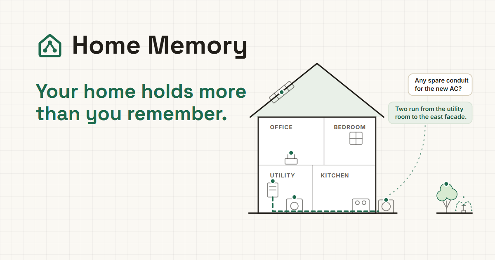
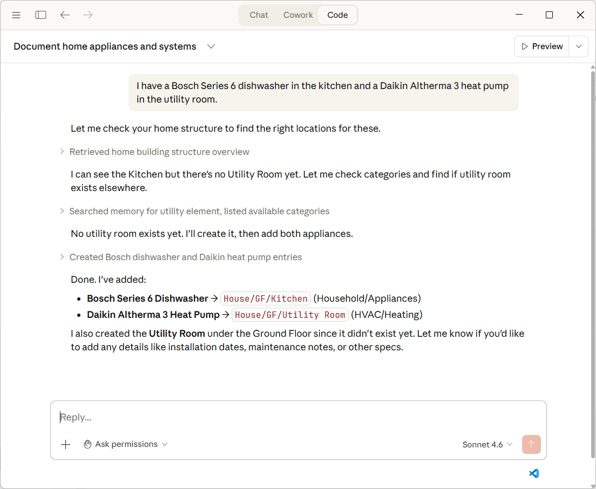
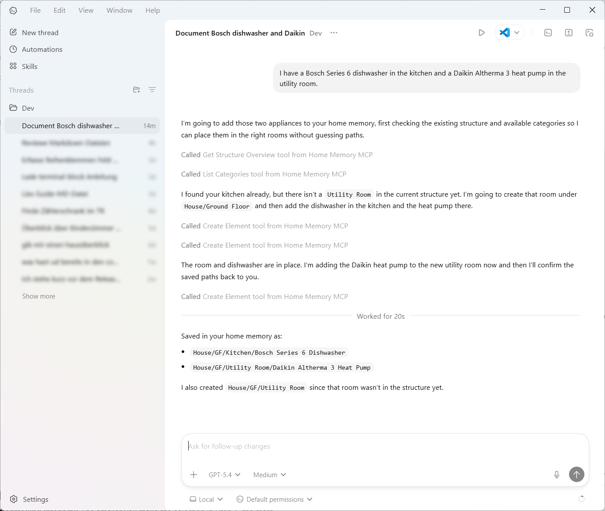

<p align="center">
  <h1 align="center">Home Memory</h1>
  <p align="center"><strong>Ask your home.</strong></p>
  <p align="center">Your AI assistant's memory for everything in and around your home.</p>
</p>

<p align="center">
  <a href="LICENSE"></a>
  
  
</p>

<p align="center">
  <a href="https://home-memory.com">
    
  </a>
  <br>
  Prefer a less technical introduction? Visit <a href="https://home-memory.com">home-memory.com</a>.
</p>

---

Home Memory is an [MCP server](https://modelcontextprotocol.io/) that gives your AI assistant structured, persistent knowledge about your home: every room, every device, every pipe and cable, every item you own.

It works with the ChatGPT desktop app, Claude Desktop, Claude Code, Codex CLI, and other MCP-compatible AI apps. You talk naturally; the AI reads and writes your home data through Home Memory's tools.

Document what exists, plan what's coming, and keep track of what's been removed.

No app to learn. No forms to fill out. Your home data stays in a single file on your machine, and the AI *is* your interface.

Tell your AI about your heat pump, your car, your power tools, or your wine collection, and it extracts the relevant details and stores them as structured data in your local database. Snap a photo of a device or hand it an invoice. Same result. Ask "What's in the basement?" or "When is my car due for inspection?" and get answers from real data.

<p align="center">
  
  <br>
  <em>Claude Desktop (Anthropic)</em>
</p>

<p align="center">
  
  <br>
  <em>Codex (OpenAI)</em>
</p>

## What you can do

**Document anything by just talking:**
> "I have a Daikin Altherma heat pump in the utility room."

Your AI finds the right category, resolves the location, and creates the element. No manual data entry.

> "My car is a 2023 Toyota Corolla Hybrid, next inspection is due in March."

Not just building infrastructure: vehicles, tools, appliances, valuables, anything that belongs to you.

**Ask questions about your home:**
> "What's in the basement?" &middot; "Show me all planned purchases." &middot; "Where is my washing machine?"

**Upload a photo and let your AI identify it:**
> *(attach a photo of a device)* "What is this? Add it to the utility room."

Vision-capable AIs recognize the device and create the element via MCP.

**Read an invoice and extract devices:**
> *(attach a PDF invoice)* "Extract the installed devices and add them to my home."

**Track connections between elements:**
> "The circuit breaker panel feeds the kitchen outlet via NYM-J 3x1.5."

Cable routes, pipe runs, duct paths, all documented as connections between elements.

**Plan renovations:**
> "We're planning a PV system on the roof." &middot; "The old oil heater was removed last year."

Track what's planned, what exists, and what's been removed.

## Quick Start (Windows)

The release ZIP is self-contained. No .NET or Firebird installation is required. You need one of the local AI clients listed below.

### Set up with your local AI

Already use Codex or Claude Code locally on your Windows PC? It can help install and configure Home Memory. Paste this prompt:

> Set up Home Memory from https://github.com/impactjo/home-memory on this Windows PC. Follow its README and Setup Guide, use the latest official release ZIP, and register it with the local AI client I am currently using. First check whether Home Memory is already installed or registered. Preserve existing client configuration and any existing Home Memory database, and update an existing registration instead of creating a duplicate. Ask for explicit confirmation before replacing an existing installation or migrating a database. Tell me when registration is complete and whether I need to restart the client or start a new session.

After registration, continue with **3. Try it** to verify the connection.

Prefer to set it up yourself? Continue with **1. Download & Extract** below.

### 1. Download & Extract

1. Download the latest release ZIP from [GitHub Releases](../../releases)
2. Extract to a folder, e.g. `C:\HomeMemory\`

### 2. Connect to your AI

Choose **one** of the following clients and use a local session on the computer where you extracted Home Memory. A cloud session does not automatically have access to this installation. For phone access to the same computer, see **4. Use it from your phone** below.

<details>
<summary><strong>ChatGPT desktop app (Codex)</strong></summary>

1. Open the ChatGPT desktop app and select **Codex**
2. Open **Settings** → **MCP servers**
3. Click **Add server**
4. **Name:** `home-memory`
5. Choose transport **STDIO**
6. **Command:** `C:\HomeMemory\HomeMemoryMCP.exe` (adjust if you extracted it elsewhere)
7. Save the server, then select **Restart**

Or via Codex CLI:
```bash
codex mcp add home-memory -- "C:\HomeMemory\HomeMemoryMCP.exe"
```

The desktop app, Codex CLI, and IDE extension share MCP configuration on the same host, so register Home Memory only once. See the [official MCP guide](https://learn.chatgpt.com/docs/extend/mcp) for current client instructions.

</details>

<details>
<summary><strong>Claude Desktop</strong></summary>

1. Open Claude Desktop
2. Click the **Claude menu** → **Settings** → **Developer** → **Edit Config**
3. This opens the config folder with `claude_desktop_config.json` selected. Open it in any text editor
4. Add `home-memory` inside the `"mcpServers"` object:

```json
{
  "mcpServers": {
    "home-memory": {
      "command": "C:\\HomeMemory\\HomeMemoryMCP.exe"
    }
  }
}
```

If you already have other MCP servers configured, add the `"home-memory"` entry next to them inside the existing `"mcpServers"` block.

5. Save the file and restart Claude Desktop

Home Memory is available in the Chat tab and in local Code tab sessions. The **Code tab is recommended for multi-step, agentic workflows that use several MCP tools**.

If the same server name is also configured in Claude Code, local Code tab sessions use the Desktop definition. The standalone Claude Code CLI needs its own registration below. See [Claude's configuration sharing rules](https://code.claude.com/docs/en/desktop#mcp-servers-from-the-claude-desktop-chat-app).

</details>

<details>
<summary><strong>Claude Code (CLI)</strong></summary>

```bash
claude mcp add home-memory --scope user -- "C:\HomeMemory\HomeMemoryMCP.exe"
```

Check the connection with `/mcp` in Claude Code. If Home Memory is not available yet, start a new session.

</details>

### 3. Try it

On first launch, Home Memory automatically creates a local database with over 100 categories and an initial example structure (floors, rooms, garage, outdoor areas). No setup wizard needed.

**First, verify that your AI can use Home Memory:**

> "Use the Home Memory MCP tool `get_structure_overview` to show me the structure currently stored in Home Memory. If the tool is unavailable, tell me instead of guessing."

You should see the initial example structure, including a ground floor, upper floor, basement, and several rooms. This confirms that your client can discover and call Home Memory's tools.

If Home Memory is unavailable or reports an error, see [Troubleshooting](docs/SETUP-GUIDE.md#troubleshooting).

Once this works, you normally do not need to mention Home Memory or individual tool names. Continue naturally:

> "I have a Bosch washing machine in the basement."

Your AI creates the element, finds the right category, and places it in the basement, all in one step. Ask "What's in the basement?" to verify.

> "We're planning to install a heat pump in the utility room."

Creates a planned element, so you can track what exists and what's coming.

**If it works, setup is complete.** From here, you can work with your AI in natural language to adapt the example structure, add appliances, furniture, or tools, and capture details from photos or invoices.

### 4. Use it from your phone (optional)

Home Memory runs locally, but you can use it from your phone through remote access in Claude Code or the ChatGPT desktop app. In both cases your Home Memory database and MCP server stay on your machine; the phone is just a remote window into a session running on that host.

Handy whenever you are away from your computer and want to look something up or capture it on the spot, whether at the fuse box, out in the garden, or snapping a photo of a new appliance.

- **Claude Code:** start a local session, enable [Remote Control](https://code.claude.com/docs/en/remote-control), then continue it from the Claude mobile app or `claude.ai/code`. Requires a signed-in Claude account.
- **ChatGPT desktop app:** start [Remote setup](https://learn.chatgpt.com/docs/remote-connections) on your host machine, then pair your phone by scanning the displayed QR code with the ChatGPT mobile app.

### Build from Source (advanced)

See [Building from Source](docs/SETUP-GUIDE.md#building-from-source) in the Setup Guide for prerequisites, build commands, and Firebird configuration.

## How it works

```
You ──── AI Assistant ──── Home Memory MCP ──── Local Database
(natural language)           (24 tools)    (Firebird, single file)
```

Home Memory implements the [Model Context Protocol (MCP)](https://modelcontextprotocol.io/), an open standard that lets AI assistants use external tools. When you talk to your AI about your home, it calls Home Memory's tools behind the scenes to read, create, update, and search your home data.

**Your data stays local.** The database is a single file on your machine. Nothing is sent anywhere except to the AI you're already talking to.

## Features

### 24 MCP Tools

| | Tools | What they do |
|---|---|---|
| **Explore** | `get_structure_overview`, `find_element`, `list_elements`, `get_element_details`, `get_recent_changes` | Browse your home, search by name/path/status, get full details |
| **Manage Elements** | `create_element`, `update_element`, `delete_element`, `move_element` | Add devices, furniture, fixtures, or entire rooms and floors |
| **Connections** | `get_connections`, `get_connection_details`, `create_connection`, `update_connection`, `delete_connection` | Document physical lines: cables, pipes, ducts, conduits |
| **Categories** | `list_categories`, `get_by_category`, `get_category_details`, `create_category`, `update_category`, `delete_category` | Over 100 built-in, editable categories across all domains |
| **Status** | `list_statuses`, `create_status`, `update_status`, `delete_status` | Track what's existing, planned, or removed |

### Covers every domain, fully customizable to your needs

Electrical (circuits, PV, wallbox, home automation) &middot; HVAC &middot; Plumbing &middot; IT & Communications &middot; Security (alarm, fire, surveillance) &middot; Building Materials &middot; Landscaping (garden, pool, irrigation) &middot; Household (appliances, furniture, valuables) &middot; Vehicles &middot; Tools &middot; Health &middot; Sports & Leisure

Every category, every element, every status is editable. Rename, add, or remove anything to match how you think about your home.

### Smart defaults

- **Over 100 categories** organized by trade and domain, from circuit breakers to garden sprinklers to vehicles
- **Default house structure** with floors, rooms, garage, and outdoor areas, customizable by talking to your AI
- **Auto-setup** on first run, no manual database creation needed
- **Flexible naming**: your AI can use "Ground Floor" or "GF", the server resolves both

## Compatibility

| Client | Status |
|---|---|
| ChatGPT desktop app (Codex) | Tested |
| Claude Desktop (Chat tab + Code tab) | Tested |
| Claude Code (CLI) | Tested |
| Codex CLI (OpenAI) | Tested |
| Any MCP-compatible client | Should work (stdio transport) |

The release ZIP is a self-contained Windows build with all dependencies included (no .NET or Firebird installation required). On macOS and Linux, you can build from source with .NET 10 and Firebird 3; see the [Setup Guide](docs/SETUP-GUIDE.md) for details.

## Configuration

| Environment Variable | Purpose | Default |
|---|---|---|
| `HOME_MEMORY_DB_PATH` | Database file location | `%LOCALAPPDATA%\HomeMemory\homememory.scd` (Windows) · `~/.local/share/HomeMemory/homememory.scd` (Linux) · `~/Library/Application Support/HomeMemory/homememory.scd` (macOS) |
| `HOME_MEMORY_FBCLIENT` | Path to Firebird client library | Bundled with release / Firebird installation |

## HTTP mode (LAN, optional)

Stdio is the default and works for almost everyone. HTTP mode lets you run Home Memory as a persistent service on a NAS, homelab box, or another machine on your LAN. See [docs/HTTP-MODE.md](docs/HTTP-MODE.md) for setup, database locking, LAN access, and HTTP security requirements.

## Architecture

- **.NET 10** with [ModelContextProtocol SDK](https://github.com/modelcontextprotocol/csharp-sdk)
- **Firebird Embedded**: local database engine, single-file storage
- **Raw SQL** with recursive CTEs, no ORM overhead, transparent and auditable

## Contributing

Home Memory continues to evolve, and feedback is welcome. Right now, the best way to contribute is:

- **Open an issue** for bug reports, feature ideas, or questions
- **Share your use case**: how are you using Home Memory? What's missing?
- **Spread the word** if you find it useful

If you'd like to build and explore the code locally, see the [Setup Guide](docs/SETUP-GUIDE.md).

## Background

Home Memory builds on a proven data model from [Smartconstruct](https://smartconstruct.io), a desktop application for documenting physical assets, refined through real-world use in residential construction projects.

## License

[AGPL-3.0](LICENSE)

---

<p align="center">
  <a href="https://home-memory.com">home-memory.com</a>
</p>
